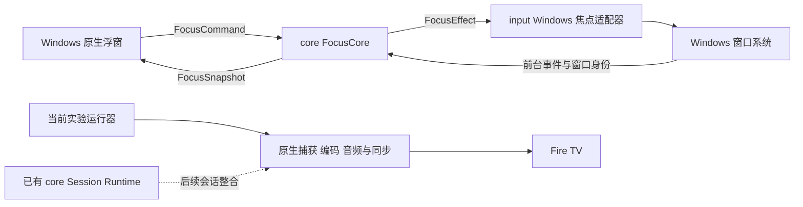

# 桌面浮窗与焦点切换架构

游戏保持在虚拟屏幕上，用户通过浮窗或快捷键在游戏与之前的工作窗口之间切换焦点。这让用户临时使用电脑后快速回到电视游戏；同一登录会话仍只有一个前台窗口，并不保证游戏后台输入可用。

## 状态与适配器

`FocusCore` 是无系统调用的状态归约器，负责当前归属、工作窗口记忆、允许的命令、请求编号、确认和超时。`FocusSnapshot` 可由 TUI 和后续桌面界面复用。当前实验由桌面进程持有唯一的焦点归约器，独立运行器负责媒体启停；原 Windows 主机的 Session Runtime 保留原功能，没有接管这轮独立媒体实验。焦点操作不重启媒体。

Windows 焦点适配器位于 `crates/input/src/focus_adapter.rs`，窗口身份包含句柄、进程编号和进程创建时间。执行切换前重新校验身份，避免把已经复用的窗口或进程当成原来的工作应用。适配器不注入游戏进程、不伪造后台焦点，也不会连续自动夺回焦点。

`apps/desktop` 创建原生浮窗并监听系统前台事件。界面只根据 core 提供的状态和命令更新，不自行判断切换成功。小范围周期检查用于窗口存活与请求超时；帧捕获、编码、音频时钟与网络均不经过浮窗。

正式主机整合时，通过本机 IPC 发布 FocusSnapshot、接收 FocusCommand，并将焦点会话绑定到媒体 session token。当前实验未将焦点命令开放到电视局域网协议，也未将桌面进程变成第二个媒体主机。

## 浮窗交互

浮窗置顶且显示时不激活，持续标注“游戏获得焦点”或“电脑正在使用”。这些标签描述实际焦点归属，不代替媒体健康或手柄连接状态。“返回游戏”选择绑定的游戏窗口；“拿回电脑”选择最近一次实际使用的工作窗口。浮窗自身和桌面外壳不会覆盖工作窗口记忆。

配置电视专用屏幕后，core 同时接收游戏窗口的位置证据。游戏改分辨率或自行回到主屏时，界面标注“游戏离开串流屏幕”；“移到电视屏幕”只移动并适配窗口大小，不抢工作焦点。“返回游戏”同时恢复位置和游戏焦点，两个条件均确认后才完成请求。位置修复仅由用户命令触发，避免与游戏不断争夺窗口位置。独占全屏或拒绝移动的游戏需要在游戏内选择显示器或切换窗口模式。

Ctrl+Alt+F9 拿回电脑，Ctrl+Alt+F10 返回游戏。快捷键注册冲突时界面明确提示使用按钮。游戏窗口退出后禁用游戏切换，工作窗口退出后禁用返回该窗口，保留手动选择其他工作窗口的路径。关闭浮窗本身不发送 Steam 游戏退出命令；实验运行器会正常停止测试串流并恢复窗口位置。

切换请求显示“正在切换焦点”，实际前台窗口确认后才显示成功。Windows 拒绝或确认超时，保留真实焦点归属并显示 Alt+Tab 的处理路径。[Windows 前台规则](https://learn.microsoft.com/en-us/windows/win32/api/winuser/nf-winuser-setforegroundwindow)

## 实验运行与回退

当前实验使用 Lost Judgment 和真实 Fire TV。运行器仅在原主机处于 Idle 时启动，要求唯一的非主屏 1080p 虚拟显示器。仍采用 High profile、P4 ULL、无限 GOP、一帧 VBV、四帧客户端队列、AAudio 低延迟输出和启用的音画同步。按游戏进程捕获音频，不改变默认设备；电脑端游戏声音静音仍是单独的后续工作。

构建 `cargo build -p sofalink-desktop`；独立浮窗入口为 `desktop.ps1`。完整实机实验入口为 `experiments/game-space/run-focus.ps1 -Device <Fire TV IP> -Python <GStreamer Python> -Seconds 600`，需要 PowerShell 7。关闭浮窗或到达实验时限后，运行器通过标准输入正常停止媒体，返回电视启动页并恢复游戏原窗口位置。虚拟显示驱动的申请与回收由 `display-driver.ps1` 单独控制，只回收拥有记录的设备。

当前可用版本的回退点是 `baseline-tv-2026-10-12`。实验配置、凭据、逐帧日志和本机窗口证据保存在忽略的 `local/game-space`，不进入公共仓库。

## 本轮实机验证

用户确认浮窗操作正常。Windows 前台证据记录了返回游戏和拿回原工作窗口的请求与确认；游戏进程退出后，core 禁用了游戏命令，运行器停止媒体并返回电视启动页。窗口移动功能和位置确认已实现；用户反馈更新后的操作正常，分辨率重设导致窗口自行重建或独占全屏等情况仍需更多游戏回归。

Fire TV 使用 AAudio 模式 12，音频积压样本约 34 ms，音画同步保持开启。滚动帧率接近 60 fps，但存在低于 60 的采样窗口；本轮是交互验证，未用相同游戏片段做完整延迟前后对照，不能据此宣称物理端到端延迟没有变化。

后续将焦点契约接入主机本地 IPC 和 TUI。电视键鼠回传接入前，还需在电脑持有焦点时阻止游戏键鼠注入并释放已按下的输入；电视端不应因任意手柄操作自动抢走电脑焦点。本轮使用直接连接电脑的手柄，没有启用 TV 输入回传。
