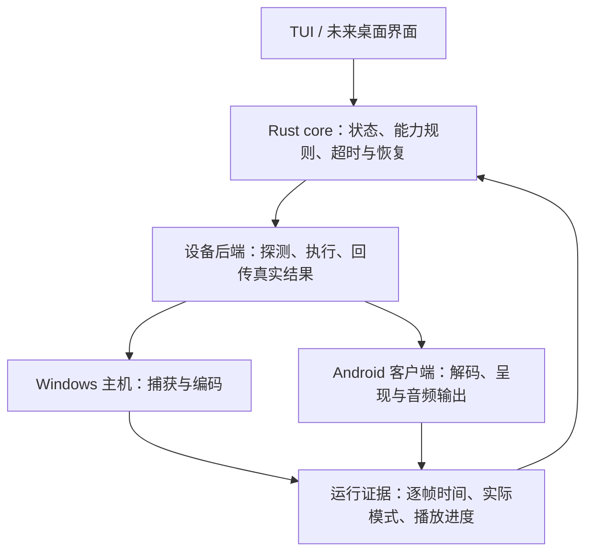

# 设备能力与适配边界

2026-10-12 更新：通用请求、实际设备探测、协商计划与共享快照已实现，见 [音视频协商及回归](media-negotiation-2026-10-12.md)。下文保留 2026-10-11 的审查记录，其中主机能力声明、固定音频格式及旧能力查询版本已由新实现替代。

2026-10-11。目标是按实际能力协商、按运行证据验证，不能把一台设备成功等同于全部设备兼容。当前性能验收范围是 Windows/NVIDIA NVENC AVC、1080p60 SDR、Android 11 Fire TV AFTKRT；另有独立 Android TV 模拟器兼容路径。未验证其他 Fire TV、其他 Android TV、AMD/Intel 编码器、macOS、4K 码流、HDR、蓝牙音频和外接音响链路。

## 责任边界

core 不依赖 Android、ADB、NVENC 或终端。平台 API 只留在适配器中。TUI 和未来桌面界面提交同一套命令、读取同一份 Snapshot；不能另写设备判断和恢复状态。实验后端仍叫 `crates/emulator`，其中已经有 Fire TV 分支，名称重整留待后端拆分，不复制一份状态机。

## 已落实的策略

| 环节 | 探测 / 决策 | 执行与证据 | 当前边界 |
| --- | --- | --- | --- |
| 编码 | core `EncodingPolicy` 协商共同 AVC profile 与 IDR 恢复能力，按目标帧率计算一帧 VBV | GStreamer 启动协商和逐帧测量；客户端请求 IDR | 主机能力仍以 NVENC 路径声明，不是通用 GPU 探测 |
| 解码 | 客户端查询硬件解码器 profile、分辨率与帧率；把所选名称传入启动 | 实际 MediaCodec 配置、解码和呈现反馈 | 能力声明不保证持续实时性能；尚未有运行时换解码器策略 |
| 显示 | 客户端查询当前输出尺寸 / Hz；core `DisplayMode::check_target` 检查刷新能力 | Activity 保留系统当前模式，不设置 preferredDisplayModeId | 刷新容量不等于均匀帧节奏，也不是原生面板尺寸探测 |
| 音频 | 请求 AAudio 低延迟独占，检查实际模式；不满足则释放并回退 AudioTrack | 实际播放时间戳、缓冲、设备 ID、共享模式和积压测量 | 回退保证可尝试播放，不保证同等延迟；48kHz stereo 固定格式 |
| 会话 | core 按递增音画反馈判断播放、失效和恢复 | 后端负责释放确认；主机静音需实际电视播放证据 | 播放健康阈值与性能验收不同；旧反馈不能证明恢复 |

显示与串流尺寸独立：1080p 码流可以输出到 4K HDMI，不能因码流尺寸强制切换显示模式。60 fps 目标允许 59.94 Hz；30/50/59 Hz 输出会在 Fire TV 启动预检失败，提示用户选择合适的系统模式。120 Hz 可通过容量检查，但是否准确重复每帧仍需逐帧验收。默认不自动降到 30 fps，避免改变用户目标而不说明。

本次移除了“当前低于 59 Hz 时自动选择同尺寸 60 Hz”的旧分支。同尺寸刷新变化也可能导致 HDMI 音频路由重建。能力查询协议升级为 version 2，增加 `display: {width,height,refreshHz}`；旧 APK 会被明确拒绝，需要同步更新。当前只在真实 Fire TV 后端做该预检，模拟器仍使用独立测试路径。

## 后续通用化顺序

1. 把主机 GPU 探测做成实际能力结果，保留 NVENC / QSV / AMF 各自执行适配器；未实现的编码器明确返回不支持。
2. 用带版本的请求、能力和执行结果合同替代后端中固定的 1080p60 请求。码流尺寸、显示尺寸、色彩、音频格式分别表达；用户目标与协商结果分别保留。
3. 增加显示变化 / 音频路由变化事件。重新采集能力并使旧时间映射失效，经新的播放证据才恢复；不能把陈旧设备 ID 或时间戳当成新设备证据。现在已有音频断连重开与会话恢复，但没有完整显示变化订阅。
4. 把运行性能等级和具体回退原因纳入共享 Snapshot，再由界面呈现。当前有状态和诊断指标，但“低延迟可用 / 兼容输出”尚未形成完整的共享产品状态。
5. 建立设备验收矩阵：不同输出尺寸 / Hz、硬件解码器、音频路径和网络条件分别测吞吐、帧节奏、真实音画同步与异常恢复。增加设备不能引入 core 中的型号分支。

设备特例只允许存在于平台适配层，附带复现条件、原因和撤销条件。当前 goldfish 软件解码兼容和 Fire TV 设备确认仍属于具体后端，不代表已有通用 Android TV 产品入口。不能把诊断开关暴露成普通用户必须理解的配置。

## 验证与限制

新增 core 策略测试覆盖 720p/1080p/4K 输出、59.94/60/120 Hz、容量不足和无效能力。Rust 工作区检查及客户端 RTP / 时钟测试通过，APK 编译和签名验证通过；真实设备只做安装和只读能力复查，本次没有再次开始串流。此前音视频、颜色和恢复实测见 [Fire TV 音频与显示故障报告](audio-mmap-recovery-2026-10-11.md)。

新版 APK 已安装，Fire TV 查询返回 version 2、输出 3840×2160 / 59.9399986 Hz、1080p60 硬件解码器 `OMX.MTK.VIDEO.DECODER.AVC`、High/Baseline 支持。未强制改变输出模式，也未启动音视频测试。

平台依据：[Android 帧率与非无缝模式切换](https://developer.android.com/media/optimize/performance/frame-rate)、[Oboe 实际流属性可能不同于请求](https://github.com/google/oboe/blob/main/docs/FullGuide.md)。
