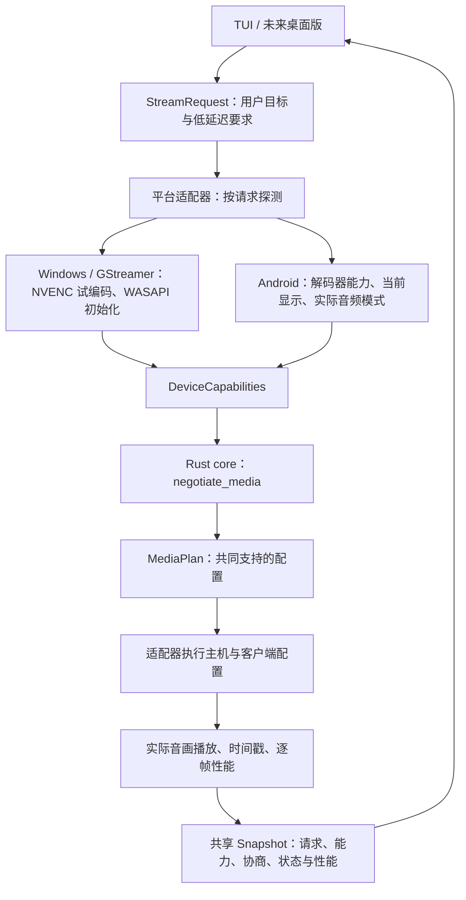

# 通用设备能力与音视频协商

2026-10-12。默认目标仍为 1080p60 / 20 Mbps / SDR709 / 48kHz stereo PCM，但这些是 core 的默认请求，不是主机与客户端各自猜测的参数。真实设备启动和异常恢复都会重新探测并协商；不支持的请求明确失败，默认不降低目标、不扩大缓冲、不关闭同步。

## 合同与边界



- `StreamRequest` / version 1：codec、尺寸、目标帧率、码率、色彩、音频格式及 `require_low_latency_audio`。JSON 拒绝未知字段、错误类型、非法尺寸与不支持的版本。
- `DeviceCapabilities` / version 1：请求对应的硬件 AVC 模式/profile、实现标识、按需 IDR、色彩与码率上限；音频格式和实际低延迟输出模式；当前显示输出尺寸和 Hz。显示字段不能解释为原生面板尺寸。
- `MediaPlan` / version 1：保留原请求、选择的编码器和解码器、共同 profile、无限 GOP、一帧 VBV，以及保留当前显示模式的策略。
- `MediaNegotiation` 同时保留双方能力和计划。core 会重新计算并验证后端回传的计划；不匹配、旧 token 和不正确阶段的结果不能启动主机。

类型和纯规则位于 `crates/core/src/media.rs`。core 只依赖 serde，不引入 Android、ADB、NVENC、文件或终端 I/O。设备探测与执行位于 `crates/emulator/src/media_adapter.rs`、`experiments/stream/probe-host.py` 和 Android `MediaCapabilities` / `AndroidDecoderAdapter` / `AudioOutput`。MTK 私有提示、goldfish 兼容与 Windows 插件名称留在适配器。

Snapshot 新增 `stream_request` 和 `media_negotiation`；使用 serde 的默认字段保持已有快照的可读性，Snapshot 的外层版本仍为 1。TUI 从状态中呈现尺寸、采样率和声道，不复制协商规则。状态中的已协商配置在结束后保留作诊断，在新开始或恢复时清除；不能把 Idle 中的历史计划当成当前设备能力。桌面版继续使用相同 Runtime、Command、Snapshot；本次未新增桌面界面或独立状态机。

## 实际探测与执行

Windows 对请求的尺寸、帧率、码率分别尝试 High / Baseline 的三帧原生 NVENC 编码，只有收到 EOS 的组合才进入能力结果；读取编码器码率属性上限，验证必要的捕获、编码与传输插件。WASAPI 回环、格式转换与重采样管线尝试初始化。探测有取消和 15 秒上限，不在逐帧路径中执行。它验证初始化与编码兼容，不证明桌面捕获持续帧率或音频捕获端到端延迟。

Android 查询全部硬件 AVC 解码器，检查请求尺寸/帧率、profile 对应的 AVC level 和码率范围。音频除了 AudioTrack 格式支持，还临时打开并释放实际输出，报告 AAudio / AudioTrack 真正取得的低延迟模式。捕获适配器的 `low_latency_output` 为 null，不能冒充输出模式。

默认 `require_low_latency_audio=true`，客户端没有取得低延迟输出则协商失败。实际开播及断连重开后再检查一次，防止探测后设备条件改变。`false` 是显式允许兼容播放，性能反馈仍报告实际模式和积压，不能据此声称达到游戏串流延迟目标。诊断后端覆盖选项保留为有界实验入口，不能解释为普通计划的性能验收。

主机与客户端使用同一计划中的尺寸、fps、码率和采样率。媒体仍走 D3D11 / NVENC、MediaCodec、AAudio 回调和有界队列。音频时间换算、ring 时间映射、20ms 预算和网络旧包阈值随实际采样率计算，没有扩大默认 48kHz 缓冲。

健康帧率下限为目标的 75%，用于发现会话失效，不是性能达标线。性能状态和离线报告的长帧判断使用目标周期的 1.5 倍，编码预算为目标周期；30fps 的正常 33.3ms 间隔不会按旧 60fps 阈值误判。Surface 延迟等毫秒指标仍是独立测量边界。

## 使用

```powershell
# 默认目标由 core 提供
./start.ps1 -FireTv
# 从同一合同设置目标
./start.ps1 -FireTv -StreamRequest examples/stream-720p30.json
# 有界诊断与实际异常恢复回归
./target/debug/sofalink-tui.exe --fire-tv <IP> --stream-request examples/stream-1080p60.json --diagnostics --measure 20
./target/debug/sofalink-tui.exe --fire-tv <IP> --verify
```

示例：[1080p60](../examples/stream-1080p60.json)、[720p30](../examples/stream-720p30.json)。客户端能力查询使用 `media` 方法和 version 1 的媒体合同，替代旧 `avc` 查询；需要同时更新控制端与 APK。

## 回归结果

Windows 与真实 AFTKRT，HDMI 保持 3840×2160 / 59.94Hz；实际桌面、Windows 捕获的咖啡厅环境声、音画同步开启。没有虚拟设备、默认输出切换或音量修改。

| 请求 / 场景 | 结果 |
| --- | --- |
| 1080p60 / 20Mbps / 48kHz | 约 59.94fps；实际低延迟输出 8ms，音频积压约 34ms |
| 720p60 / 12Mbps / 48kHz | 成功播放和结束，实际约 59.4–59.9fps；8ms 输出、约 34ms 积压 |
| 720p30 / 8Mbps / 48kHz | 成功进入 Playing 并结束；主机 30fps，客户端约 30fps；没有按旧 45fps 健康线误判 |
| 720p60 / 44.1kHz 格式实验 | 兼容播放成立，但退到普通模式，约 238ms 积压；因此加入默认低延迟要求，不能作为性能通过 |
| 默认目标，客户端 / 主机真实中断 | 每次恢复重新探测、重新协商；89 份健康反馈、3 次确认静音，结束与启动取消通过 |

测试通过：Rust 格式、Clippy、工作区测试、依赖方向、7 个模拟恢复场景；客户端 RTP / 视频时钟 / 音频时钟；Fire TV 上运行的原生 ring、静音时间映射、并发所有权及 44.1kHz 时间换算；APK 编译和签名；原生按需 IDR 检查。

初次默认目标 35 秒逐帧记录 `local/sessions/1791773528903715500-1-0.jsonl`，报告 `local/fire-tv-check/media-negotiation-default-report/report.md`：排除预热后 1768 个匹配帧，捕获→Surface P50/P95 111.076/124.489ms，音频积压 P50/P95 34.396/34.875ms，编码 P95 7.682ms。实际滚动帧率约 59.94，但有效回调窗口速率为 56.76fps，长间隔 22/1767（1.25%），还有缺失回调；不能把滚动 60fps 说成完美帧节奏。该记录在最终严格音频模式门槛加入前取得，媒体参数和热路径相同；最终版本另做模式门槛与恢复验收。

该轮与此前桌面内容和系统负载不完全相同，不能据此声称延迟改善。Surface 比目标晚约 42ms 的问题仍未解决。没有新增物理音画同步、输入到电视光子延迟或肉眼颜色确认；保留已有 SDR709 / 无限 GOP 策略。

## 支持范围

收尾版本再次通过真实中断、恢复、结束和启动取消验收：87 份健康反馈、3 次确认静音，最后呈现 59.937fps、音频积压 34.063ms、实际低延迟输出 8ms。记录 `local/fire-tv-check/media-negotiation-final-verify.log`。严格 44.1kHz 请求被拒绝，确认临时探测客户端进程已释放，记录 `local/fire-tv-check/media-negotiation-final-rejection.log`。

音频 flush 保留实际采样率；原生 ring 使用逐包整数余数累加，避免逐样本动态除法，并通过 44.1kHz 初始化 / 重置后的时间映射测试。探测临时打开的客户端进程也纳入失败与取消的清理，AAudio 释放失败不再被忽略。最终状态 Idle、无媒体监听和客户端进程，电脑未静音、无静音租约；音量未由程序写入，保留用户当前设置。

当前执行适配器实现 AVC / SDR709 / stereo S16LE，音频格式可表达 48kHz 与 44.1kHz，但是否适合低延迟必须探测。未实现 HEVC、HDR、环绕声、AMD/Intel 编码器和 macOS。模拟器仍保留独立的软件解码兼容路径，明确只接受默认请求，不把它当作真实设备硬件性能证据。

运行时显示变化订阅、更多 GPU 适配器、音频输出与码流采样率独立转换和更广设备矩阵仍待实现。当前有断连重开及重新协商，不代表任意 HDMI 热插拔都能无缝恢复，也不承诺所有设备均可达到同样性能。
