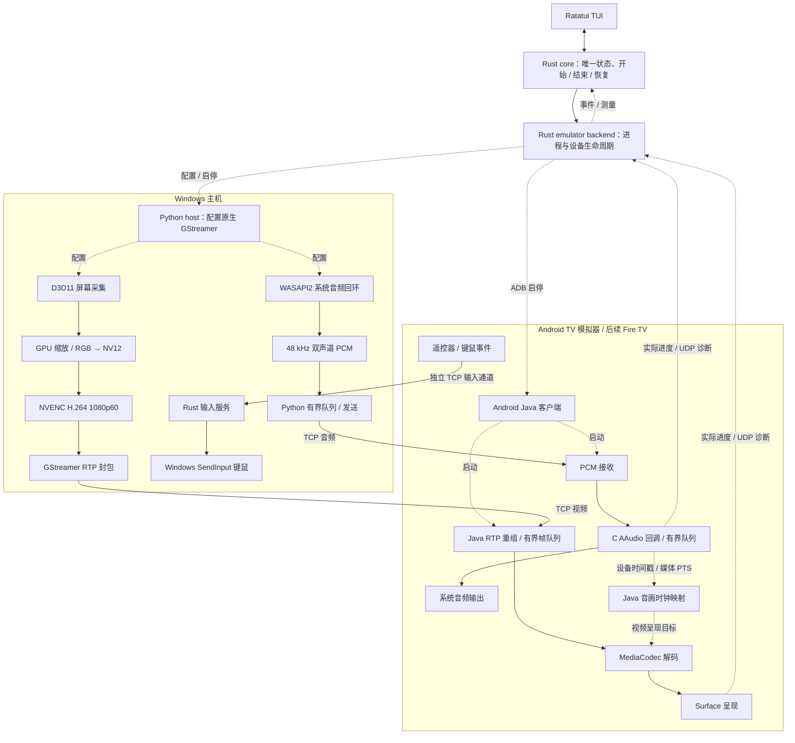
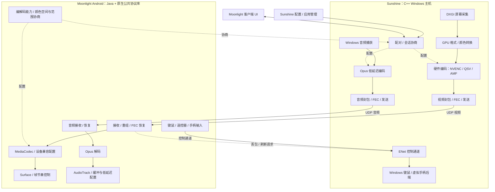

# Sunshine 与当前游戏串流架构

对照日期：2026-10-11。这里比较源码中的设计与本项目实际代码，未运行 Sunshine/Moonlight 的同场景性能基准，不能据此宣布谁延迟更低。Sunshine 是主机端；电视端应与 Moonlight 一起比较。

## 当前实际架构

实线是媒体 / 输入路径，虚线是会话控制或状态反馈。以下画的是正在使用的模拟器 TCP 会话；代码另有基础 UDP 视频选项，但尚无完整 FEC / 丢包恢复。

视频像素由原生 GStreamer / GPU 处理，不经过 Python 或 Rust core。音频 PCM 和主机测量探针仍接触 Python。Surface 反馈不是屏幕物理发光时间；图中的音频时钟驱动调度也不等于已经验收物理音画同步。

## Sunshine + Moonlight Android 架构

这是 Windows 主机与 Android 客户端的简化架构，不代表所有平台使用相同捕获后端。

对应上游源码：文末 Windows 捕获、video.cpp、audio.cpp、stream.cpp、input.cpp 与 Moonlight Android 音频输出链接；颜色协商和解码器配置见 [MediaCodecDecoderRenderer.java](https://github.com/moonlight-stream/moonlight-android/blob/master/app/src/main/java/com/limelight/binding/video/MediaCodecDecoderRenderer.java)。

## 优化顺序与验收

| 优先级 | 改动 | 依据与验收 |
|---|---|---|
| 1 | 在真实 Fire TV 上测低延迟音频与音画时钟，再调整缓冲预算 | 当前模拟器未取得低延迟模式且没有 FastMixer；同步等待中位约 113ms。固定测试源与真实游戏都要测，记录声音欠载、同步误差、端到端 P50/P95/P99，不以关闭同步获得的低延迟算收益 |
| 2 | 建立明确的客户端能力与媒体配置契约 | 协商分辨率、帧率、编解码 profile、颜色矩阵 / 范围 / 传递特性、音频模式；保留实际采纳值。颜色修复只针对 goldfish，真实设备默认 SDR709；用 RGB / 灰阶截图验收 |
| 3 | 将基础 UDP 视频扩展为按期限恢复的媒体传输，并接入 UDP 音频 | 增加包序号、帧截止时间、乱序重组、有界抖动缓冲、丢包反馈、IDR 请求与适量 FEC；分别测干净网络、丢包和抖动下的长帧、恢复时间、音频连续性。不是简单替换 socket 就完成 |
| 4 | 将主机 PCM 发送与热路径测量移入 Rust / 原生媒体运行时 | 减少 Python 回调、分配与调度变动；仍保留 GStreamer GPU 管线。迁移前后用同一逐帧记录比较，不能预先承诺固定延迟收益 |
| 5 | 引入 Opus 低延迟模式、按时间预算管理队列和反馈码率 | PCM 净负载 1.536Mbps；Opus 降带宽但也增加编解码工作。编码前可丢旧原始帧，解码前不可任意丢 H.264 参考帧；输出丢弃与 IDR 恢复分开处理。按实测设预算，不直接把所有队列减到一帧 |

建议未来组织为 `core`（状态与策略）、媒体运行时（GStreamer / 原生音频 / 网络）、客户端能力与协议契约、TUI / 桌面 UI。媒体运行时回报实际进度，core 发布状态快照；高频媒体事件不逐个进入 UI 状态机。模拟器 backend 继续负责设备与进程测试，通用媒体实现应逐步从 emulator 边界中分离。

这次仅更新架构分析，没有改变运行路径。音频证据见 [优化实测](audio-optimization-2026-10-11.md)，颜色证据见 [截图诊断](color-diagnostics-2026-10-11.md)。

| 层 | Sunshine / Moonlight | sofaLink 当前实现 |
|---|---|---|
| 会话与交互 | Sunshine 主机管理会话，Moonlight 独立客户端；游戏启动与配置属于主机能力 | Rust core 持有唯一状态、进度证据、故障恢复和资源释放；Ratatui 消费快照，未来桌面版共用 |
| Windows 视频 | C++ 平台捕获与 GPU 转换；Windows DXGI Desktop Duplication；NVENC、QSV、AMF 等编码后端 | Python 配置原生 GStreamer：D3D11 捕获 / GPU 转换 / NVENC H.264。Rust core 不在逐帧视频路径中 |
| 音频 | Windows 原生捕获，C++ Opus 低延迟编码，再送入独立发送线程 | GStreamer WASAPI2 系统回环，48 kHz 双声道 S16 PCM 经 Python 有界队列发送；尚未做 Opus 编码 |
| 媒体传输 | UDP 音视频发送、RTP / Reed-Solomon FEC；独立 ENet 控制通道 | 当前模拟器会话用 TCP 视频与 PCM；诊断反馈与四时间戳探测用 UDP；没有媒体 FEC |
| Android 客户端 | Moonlight Android Java、原生公共协议实现、MediaCodec 视频、AudioTrack 音频；其输出有低延迟模式和缓冲大小选择 | 自写 Java RTP 重组 / MediaCodec / Surface；C AAudio 回调、有界 PCM 队列与设备时间戳映射，AudioTrack 为回退路径 |
| 音画时钟与诊断 | 主机和客户端各自承担捕获节奏、网络恢复与播放控制；不能把主机编码耗时当成整条链路延迟 | PCM 携带媒体 PTS 和 RTP 偏移；用真实设备音频时间戳调度视频；逐帧关联捕获、编码、到达、解码、目标与 Surface；跨设备时钟探测仅用于诊断 |
| 输入 | GameStream 控制协议与跨平台输入后端，包含游戏手柄路径 | Rust TCP 输入通道，Windows SendInput 键鼠、完整按键状态与断线释放；原生虚拟手柄仍未实现 |

Sunshine 的关键优势来自完整的媒体、网络和设备适配工程，不能归结为 C++ 比 Rust 快。我们的视频像素和硬件编码同样由原生 GStreamer / GPU 执行；Rust core 的状态控制不是本次发现的媒体延迟瓶颈。不过 Python 目前仍接触 PCM 字节、发送和测量探针，并非完全位于控制面。以后应按实测把热路径移入 Rust / 原生模块，保留 core 的独立边界。

PCM 立体声 48 kHz / 16 bit 的净负载为 1.536 Mbps。当前 Sunshine 源码的常规立体声 Opus 配置为 96 kbps，也有更高质量档；带宽差异不直接等于延迟差异。我们的 TCP 在本机模拟器的首包阶段很快，但真实 Wi-Fi 丢包时可能等待重传；Sunshine 的 UDP / FEC 设计提供另一种恢复取舍。这是架构推论，尚未由本项目真实电视网络实验验证。

这次优化遵循 Android 的实时回调要求：音频回调只复制预分配的 PCM、补零并发布有界时间线，不调用 Java、网络、分配器或阻塞写入。零填充不冒充已播放的收到音频；设备位置、媒体位置和观察时间以完整快照发布。请求 LOW_LATENCY 与实际取得 LOW_LATENCY 分开呈现。模拟器返回普通模式且没有 FastMixer，即使设备缓冲缩小，也不能宣称系统音频路径已成为低延迟路径。

下一步优先在真实 Fire TV 上用同一套采样验证实际音频模式、音画误差与延迟下限，再决定媒体传输与原生主机迁移的顺序；在当前模拟器上盲目压小缓冲已经测出断音和失同步。

## 原始源码与官方说明

- [Sunshine Windows DXGI 捕获](https://github.com/LizardByte/Sunshine/blob/master/src/platform/windows/display_base.cpp)
- [Sunshine 视频与编码器配置](https://github.com/LizardByte/Sunshine/blob/master/src/video.cpp)、[NVENC 实现](https://github.com/LizardByte/Sunshine/blob/master/src/nvenc/nvenc_base.cpp)
- [Sunshine 音频捕获与低延迟 Opus](https://github.com/LizardByte/Sunshine/blob/master/src/audio.cpp)、[Windows 音频后端](https://github.com/LizardByte/Sunshine/blob/master/src/platform/windows/audio.cpp)
- [Sunshine UDP、FEC、ENet 与发送线程](https://github.com/LizardByte/Sunshine/blob/master/src/stream.cpp)
- [Sunshine Windows 键鼠与虚拟手柄](https://github.com/LizardByte/Sunshine/blob/master/src/platform/windows/input.cpp)
- [Moonlight Android 音频输出](https://github.com/moonlight-stream/moonlight-android/blob/master/app/src/main/java/com/limelight/binding/audio/AndroidAudioRenderer.java)
- [Android AAudio 回调与低延迟说明](https://developer.android.com/ndk/guides/audio/aaudio/aaudio)

这些链接指向上游 master，后续版本可能变化；对照内容以本次读取为准。
