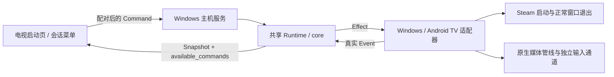

# M1 第一部分：电视启动页与 Windows 主机服务

2026-10-12，Windows + 真实 Fire TV AFTKRT。电视开始、Steam 大屏幕就绪、真实音视频与键鼠导航、电视结束、声音恢复与返回启动页已经跑通。完整 milestone 仍缺原生手柄、固定游戏持续游玩和游戏正常退出。

## 使用

电脑已开机、Steam 已安装并登录，客户端 APK 已安装。主机服务在当前登录用户会话内运行：

```powershell
./host.ps1 -Python <本机GStreamer-Python路径>
# 逐帧诊断
./host.ps1 -Python <同上> -Diagnostics
```

默认监听 TCP 47990。第一次打开电视 sofaLink，输入电脑局域网地址和主机控制台显示的六位配对码；以后保存配对凭据，打开应用即可看到 core 状态与“开始游戏”。串流中按遥控器菜单键，选择“结束会话”；长按返回也请求结束。结束确认后回到启动页，可以再次开始。

配对码有效五分钟，每个来源最多五次尝试，一份主机配置目前只配对一台电视。重新配对使用电脑 `./host.ps1 -ResetPairing` 和电视“连接设置 → 重新配对”；地址变化可以更新地址并保留凭据。ADB 只用于开发安装、截图和遥控器事件注入，日常能力探测、播放器开始/停止与确认使用局域网协议。TUI 保留用于诊断，两种入口不能同时占有媒体会话。

主机服务当前是用户会话常驻程序，安装与自启动待实现。系统 Windows 服务在 Session 0，无法直接与用户桌面交互；按 [Microsoft 交互服务设计说明](https://learn.microsoft.com/en-us/windows/win32/services/interactive-services)，Steam、捕获与输入留在交互用户会话。后续系统服务应与用户会话代理分离。

## 单一状态来源



一个 actor 持有 Runtime。电视只呈现 Snapshot 和 core 决定的可用操作；连接丢失时禁用旧操作并显示最新状态暂不可用。TUI 与未来桌面版继续共享状态契约。

Snapshot 追加通用 application 状态（target/status/message），当前目标为 desktop / steam_big_picture。Windows 适配器确认大屏幕窗口就绪后报告 Ready，core 才接受 HostReady；退出未确认时主机资源为 Unknown，不能报告 Idle 或直接重新开始。旧会话、旧代次和错误目标的事件不改变应用状态。

Steam 使用已安装客户端和正常窗口关闭，保留后台 Steam，不强杀游戏。记录窗口句柄与所有者；已发出启动请求但窗口无法确认时保留待清理记录并报告异常。下次开始先恢复上次记录，不猜测成功。游戏运行和正常退出属于下一部分。

## 控制与性能边界

长度前缀 JSON、版本 1，每请求最多 64KiB；最多八个并发连接、十六个待处理请求，头和正文共用一秒绝对读取期限。网络与 Windows/Steam I/O 均不占用 core 或媒体线程。

配对后校验 256 位系统随机凭据与设备 ID，命令还必须匹配当前主机启动实例与 core Token，拒绝重启前、旧会话及旧代次命令。网络不提供任意进程或 shell 执行接口。

媒体参数来自协商，电视回传播放器启动确认；停止要求同会话的明确停止确认，不能把“尚无播放反馈”解释成已释放。控制失联超过约 3.5 秒时关闭电视本地播放器，core 用真实反馈显示异常和恢复。控制更新约四次每秒，启动页仅在状态变化且可见时刷新。

服务操作期限：启动 60 秒、恢复 90 秒、清理 25 秒，覆盖各适配器的有界探测、Steam 启动和确认上限，不改变媒体队列或缓冲。主机退出时继续接受电视轮询和停止确认，等待 core 清理；未确认则返回失败。

D3D11/NVENC、硬件解码、AAudio、无限 GOP / 一帧 VBV、音频时钟同步和 VSYNC 策略保持。控制面不传视频或音频，不增加帧队列、不关闭同步。当前为受信任 IPv4 局域网中的明文 TCP；TLS、设备发现、多主机和互联网连接尚未实现。

## 实机证据

- 首次 Fire TV 配对成功，主机和 APK 重启后无需再次配对。
- 电视开始后 Steam 大屏幕真实播放，core 确认 Playing 后电脑静音；遥控器左右键取得四次实际 Windows 输入事件确认。
- 电视菜单结束后回到启动页，大屏幕退出，core 为 Idle、host/client stopped；电脑读回 mute=false、音量 0.10000002、lease=null。
- 在 Checking 阶段再次开始并取消，回到 Idle，没有媒体或 Steam 窗口遗留。
- 客户端进程被真实终止后，电视重新打开启动页，core 显示 Degraded；电视请求 Recover，使用新代次重建媒体和输入，恢复 Playing，随后正常结束。记录为 `local/host-state-41484.jsonl`。
- 在播放中正常关闭电脑上的 Steam 大屏幕窗口，原生 Windows 句柄/所属进程探测报告目标退出，core 自动清理并回到 Idle；不依赖反复启动 PowerShell 来监测窗口。记录为 `local/host-state-35756.jsonl`。
- 新协议播放中，70 秒有界主机服务退出触发 core 清理，电视确认停止、大屏幕退出、声音恢复，最终 Idle；退出期间仍能传递停止确认。
- 两轮短暂 Degraded 后按真实反馈恢复 Playing；没有据此宣称持续游戏体验通过。

`local/host-state-23784.jsonl` 记录控制闭环与取消，共 168 个 Playing 快照；`local/host-state-43248.jsonl` 记录播放中服务退出，共 173 个 Playing 快照，最后约 59.94fps / 音频积压 34.83ms。它们是状态采样，不是物理屏幕或听感测量。

逐帧会话 `1791783673179082100-1-0` 报告在 `local/fire-tv-check/m1-core-controlled-report/`：稳态匹配 2322 帧，长帧 34/2321（1.46%），有效回调窗口速率 57.58fps，音频积压 P95 34.938ms，仍有长帧、回调缺失和音频时钟重置需要继续定位。这是 Steam 界面功能回归，未与旧桌面素材作受控性能比较。

Rust workspace、依赖方向、格式、Clippy、模拟场景与客户端 RTP/音频/逐帧/VSYNC 检查通过。新增测试覆盖应用就绪门控、退出未确认不能重试、旧代次事件、同会话停止确认、配对尝试/过期/持久化以及慢速读取的绝对期限。

配对凭据、窗口所有权、实机地址、日志、截图与工具都留在忽略的 local/，不进入公开仓库。
